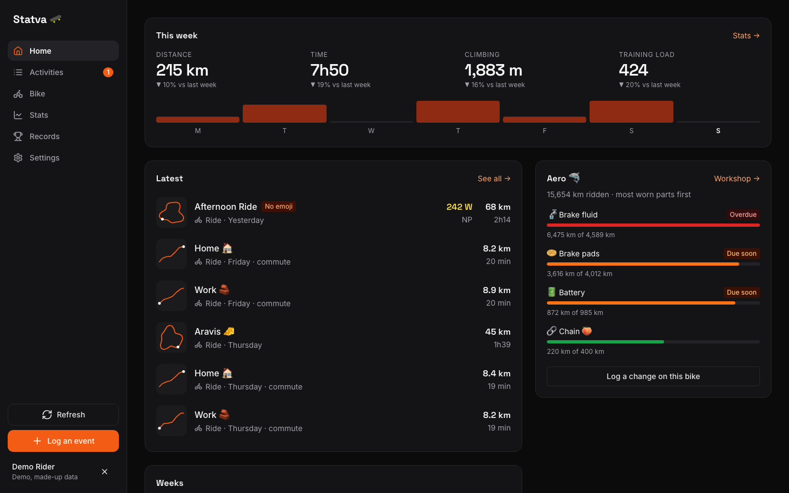
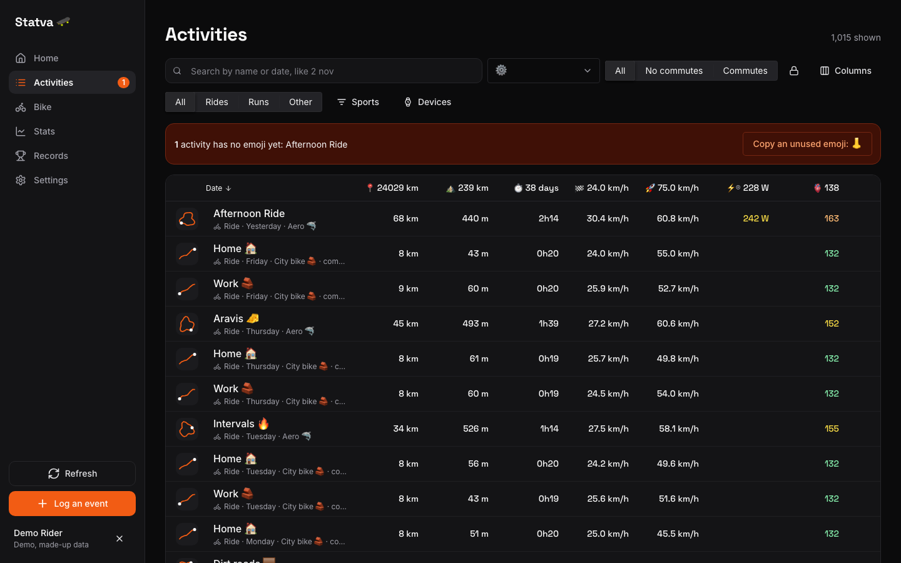
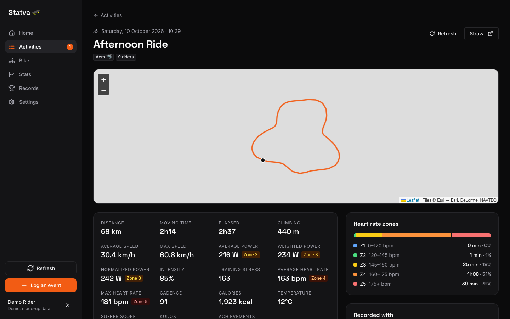
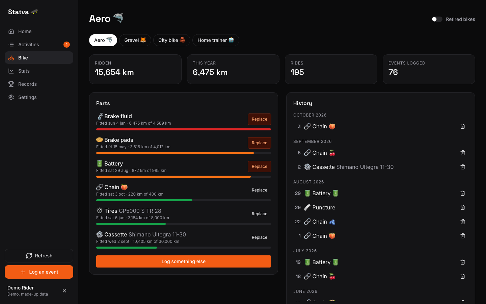
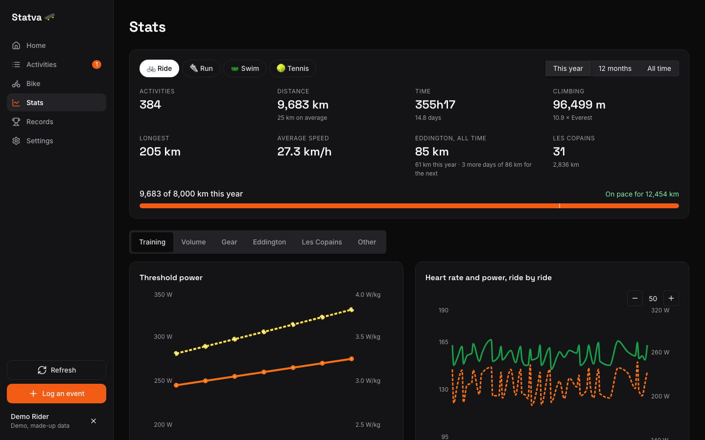
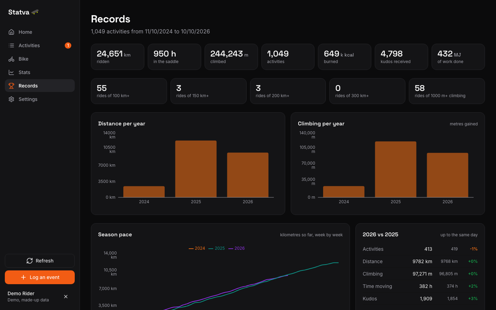
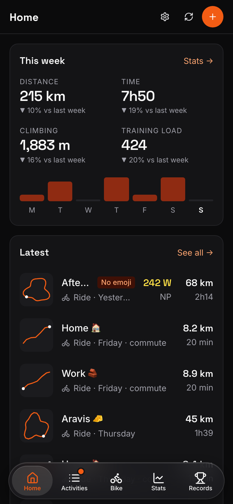
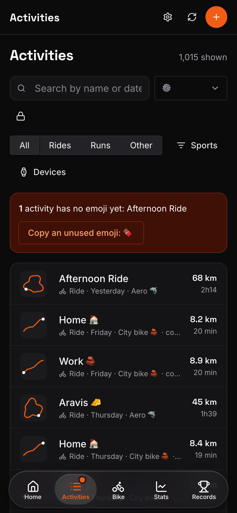

# Statva 🛹

A training log on top of Strava, for riders who also look after their bikes.

Statva reads your activities from Strava and adds what Strava does not track: bike parts
and their wear, chain rotation, maintenance, FTP tests and running costs. It turns the lot
into a home page, stats, records and an explorer map.

**Try it without an account:** open your copy (or any running Statva) and choose
"Try the demo". It runs on two years of made-up rides.



## What it does

- **Home:** this week against last week, your latest activities drawn as route shapes,
  recent weeks day by day, and the parts closest to wearing out.
- **Activities:** search by name or by date ("2 nov", "2024-11-02"), filter by sport, gear
  and commute, choose and sort columns. Each activity has its own page with its map, power,
  training stress, heart rate zones and notes.
- **Bike:** every part with its wear (chains by stint, cassettes over all their stints,
  tires, pads, battery), chain rotation with the next chain to fit, the history of every
  change, and the running cost per km. Logging a change takes two taps.
- **Stats:** totals per sport and period, the yearly goal and your pace, Eddington, and
  charts for training load, volume, gear and your club.
- **Records:** all-time totals, the hall of fame, Eddington by year, and the explorer tiles
  you have ridden, with the biggest square and the yard as Squadrats defines them.
- **Settings:** bikes, part limits, goal, heart rate, weight, club rules, language, labels.
  Export your data or disconnect from Strava (which deletes everything Statva holds).

The full feature list is in [SPECS.md](SPECS.md).

## Screenshots

All taken on the demo's made-up rides.

| Activities | One activity |
|---|---|
|  |  |

| Bike | Stats |
|---|---|
|  |  |

| Records | On a phone |
|---|---|
|  |   |

## Run your own copy

Statva runs on Vercel (the pages and a few server functions) with an Upstash Redis
database. Both have free plans that are enough for a few riders.

1. **Create a Strava API app** at <https://www.strava.com/settings/api>. Note its client id
   and client secret, and set "Authorization Callback Domain" to the domain your copy will
   use. Strava now asks API developers for a paid Strava subscription.

2. **Deploy to Vercel:**

   [](https://vercel.com/new/clone?repository-url=https%3A%2F%2Fgithub.com%2FValentinMumble%2Fstatva&env=STRAVA_CLIENT_ID,STRAVA_CLIENT_SECRET,STRAVA_ATHLETE_IDS,SESSION_SECRET&envDescription=Strava%20app%20credentials%2C%20who%20may%20log%20in%2C%20and%20a%20random%20cookie%20secret&envLink=https%3A%2F%2Fgithub.com%2FValentinMumble%2Fstatva%2Fblob%2Fmain%2F.env.example&project-name=statva)

   It asks for four settings, all explained in [.env.example](.env.example):
   - `STRAVA_CLIENT_ID` and `STRAVA_CLIENT_SECRET`, from step 1;
   - `STRAVA_ATHLETE_IDS`, your Strava athlete id (the number in your profile URL), and
     those of anyone else allowed to log in, separated by commas;
   - `SESSION_SECRET`, any long random string, for example from `openssl rand -base64 32`.

3. **Add the database:** in the Vercel project, open Storage and add Upstash for Redis.
   It sets `KV_REST_API_URL` and `KV_REST_API_TOKEN` for you. Redeploy once it is added.

4. **Log in** with "Connect with Strava". The first visit pages in your activity history,
   then fetches the details of a few activities on every visit, within Strava's limits.

5. **Register the webhook**, so new activities arrive without a visit. From a clone of the
   repo, with the same settings in `.env.local`:

   ```bash
   node scripts/webhook-subscribe.mjs https://your-domain
   ```

### Riding with friends

A new Strava API app can only be used by its owner. From its settings page you can raise
that to 10 athletes without a review; beyond that Strava reviews the app. Strava's read
limit is shared by everyone on the app: 100 calls per 15 minutes and 1,000 a day for a new
app, 200 and 2,000 after that upgrade. That is why Statva stores activities and fetches
details a little at a time.

Strava's API terms only allow showing a rider's data to that rider, so every rider sees
only their own activities.

## Develop

```bash
npm install
npm run dev
```

The dev server runs on the demo data, so it needs no account and no keys. To work against
your real data, run the server functions too with the Vercel CLI and `VITE_REAL_DATA=1`
in `.env.local`:

```bash
npx vercel dev
```

Checks:

```bash
npm test
npm run lint
npm run build
```

### Layout

- `src/app/`: the screens, their theme and components.
- `src/models/`: every calculation (parts wear, Eddington, training load, explorer tiles,
  the dashboard), each with tests.
- `src/demo/`: the made-up rides behind the demo.
- `api/`: the server functions: Strava login, the Strava and database proxies, sync and
  the webhook. Secrets never reach the browser.
- `scripts/`: one-off jobs (backfill details, find deleted activities, register the webhook).

## Your data

Statva stores your activities (as Strava sends them), your parts history, labels, FTP
tests, expenses and settings, in your copy's database, under your athlete id. The Strava
tokens stay on the server. Disconnecting from Settings, or removing Statva from
<https://www.strava.com/settings/apps>, deletes all of it.

## Licence

MIT, see [LICENSE](LICENSE).
